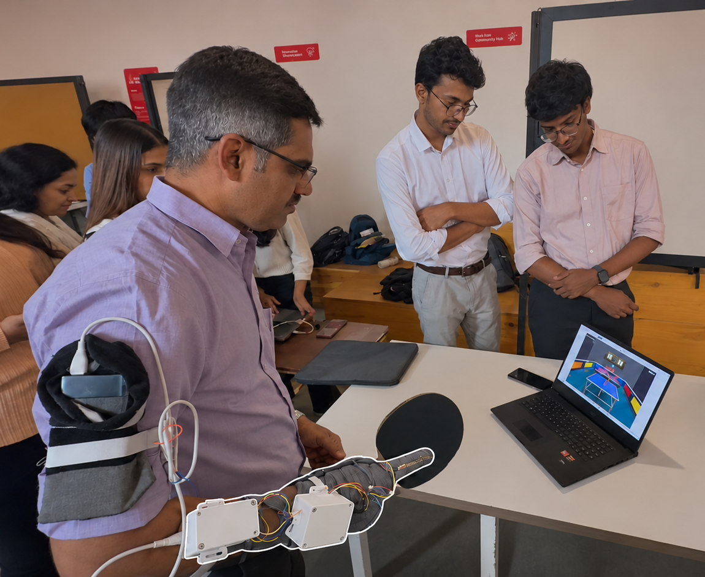
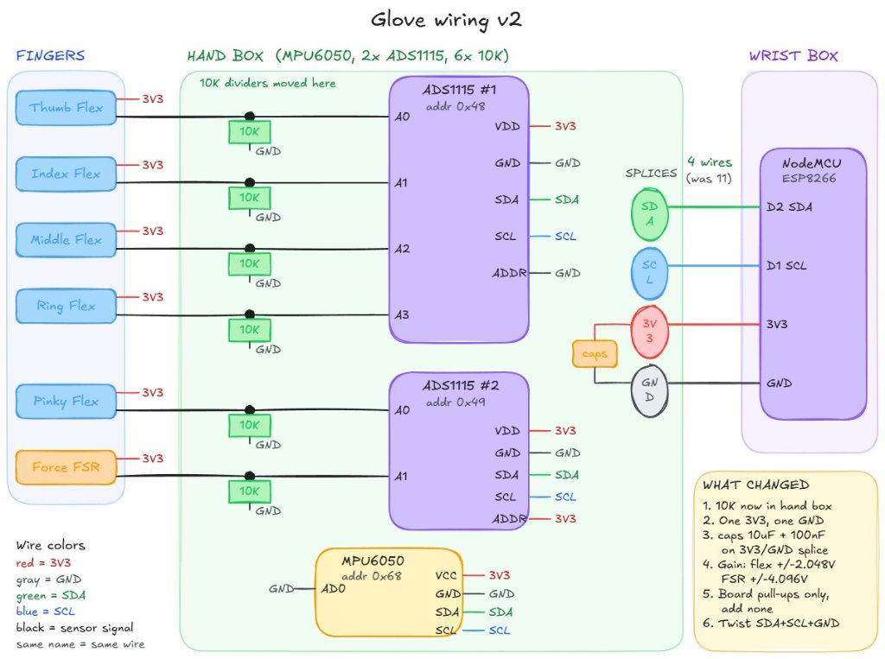
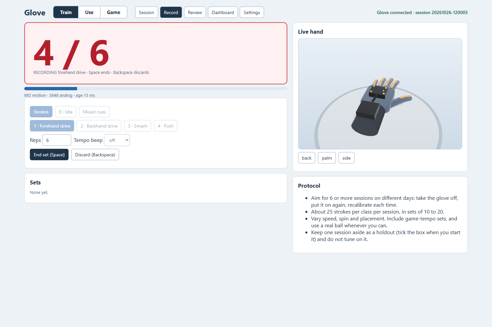
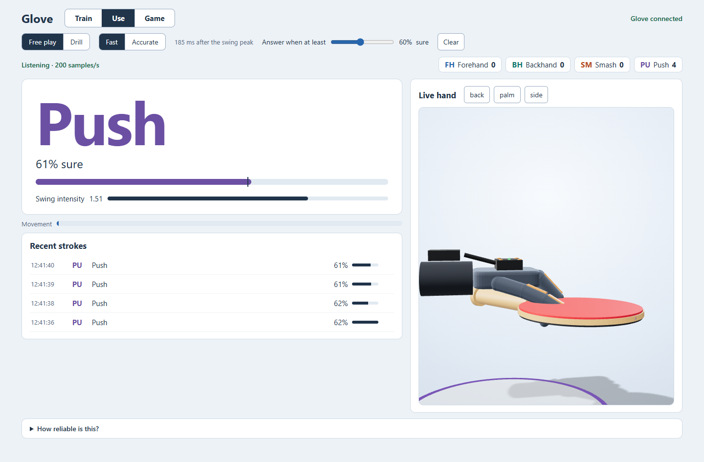
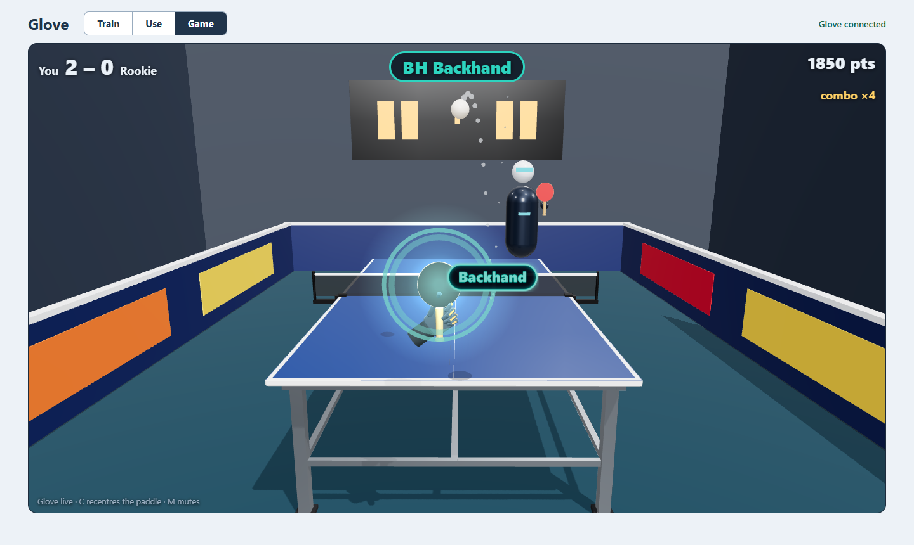

# Cadence

Cadence is a wearable IoT prototype for table tennis. An ESP8266 reads hand motion, finger bend, and palm pressure, then streams the readings over local Wi-Fi. The browser app records practice sets and uses an XGBoost model to recognize strokes live. You can also use those strokes to play a 3D rally against a robot.



[View the Cadence product poster](docs/images/cadence-poster.png).

## Hardware and wiring

| Component | Role |
| --- | --- |
| NodeMCU ESP8266 | Reads the sensors over I²C and streams data over Wi-Fi |
| MPU6050 | Measures acceleration and angular velocity at 200 Hz |
| Five resistive flex sensors | Measure how far each finger bends |
| Palm force-sensitive resistor (FSR) | Measures contact pressure |
| Two ADS1115 converters | Digitize the six analog sensor signals |

The ESP8266 sits in the wrist enclosure. The hand assembly connects to it through four wires carrying 3.3 V, ground, SDA, and SCL.



## How it works

The firmware timestamps raw sensor readings and calculates orientation, gravity-compensated acceleration, and other derived signals. The glove sends binary records over UDP to a local relay, which forwards them to the TypeScript app over WebSocket. The relay also uses WebSocket to start and stop streaming. In a five-minute phone hotspot test, the paced UDP stream lost 0.2% of the IMU and ADC records, with a longest gap of 140 ms.

For stroke recognition, the app detects a swing from acceleration and angular velocity, then extracts features from a window around the swing's peak. The XGBoost models are trained in Python and run in the browser. They classify forehand drive, backhand drive, smash, push, or none. Fast mode uses a window that ends 160 ms after the peak. Accurate mode uses 320 ms. See the [model training and evaluation notes](ml/README.md).

## Getting started

### Flash and calibrate the glove

1. Install PlatformIO. Copy `include/secrets.example.h` to `include/secrets.h` and enter your Wi-Fi credentials.
2. Run `pio run -t upload`. Open `http://glove.local/` or the IP address printed on the serial console. The 3D viewer is at `/` and the sensor bench is at `/bench`.
3. If a sensor reading appears under the wrong finger, run **Identify fingers**. Calibrate in the viewer with a flat hand, fingers up, and a fist.

### Run the web app

Install Node.js and npm. On Windows, the relay uses Python for UDP by default.

```sh
cd recorder
npm ci
npm start
```

Open [localhost:8787](http://localhost:8787) and enter the glove's address in the Session tab. To try the app without hardware, run `npm run fake-glove` from `recorder/` in a second terminal and connect to `localhost:9100`. See the [recorder guide](recorder/README.md) for calibration, recording, export, and relay setup.

## Screenshots

The recorder's simulated glove supplied the sensor input for these screenshots.

In **Train**, record labeled sets and review the detected strokes before exporting a session.



In **Use**, the app shows each prediction, its confidence, and a list of recent strokes.



In **Game**, swing the stroke shown on screen to return the ball. The timing of the swing affects the return.



## Repository layout

| Path | Contents |
| --- | --- |
| `src/` and `lib/` | ESP8266 firmware, sensor math, calibration, and binary record format |
| `web/viewer.html` | Glove-hosted 3D viewer, embedded by `tools/embed_web.py` at build time |
| `recorder/` | Vite app and local relay for recording, classification, and gameplay |
| `ml/` | Python feature extraction, model training, evaluation, and export |
| `test/host/` | Host-side firmware tests |
| `tools/` | Firmware viewer build script, stream parser, and session checker |

The firmware exposes `GET /api/calibration` and `GET /api/diag`, with `POST /api/diag/reset` to reset the diagnostic counters. The binary format is in `lib/GloveRec/GloveRec.h`, and `tools/glove_rec.py` parses it. Use `tools/check_session.py` to check an exported session.

Run the recorder tests with `npm test` from `recorder/`. To run the firmware math tests from the repository root with a C++17 compiler:

```sh
g++ -std=c++17 -I lib/GloveMath test/host/test_glovemath.cpp -o t && ./t
```

## Recordings and backups

Git ignores `include/secrets.h`, `recordings/`, and `dataset/`. Back up your recordings separately. Calibration is stored on the glove and saved with each exported session. On Windows, you can copy the recordings to a second drive with `robocopy recordings D:\glove-backup\recordings /E`.
